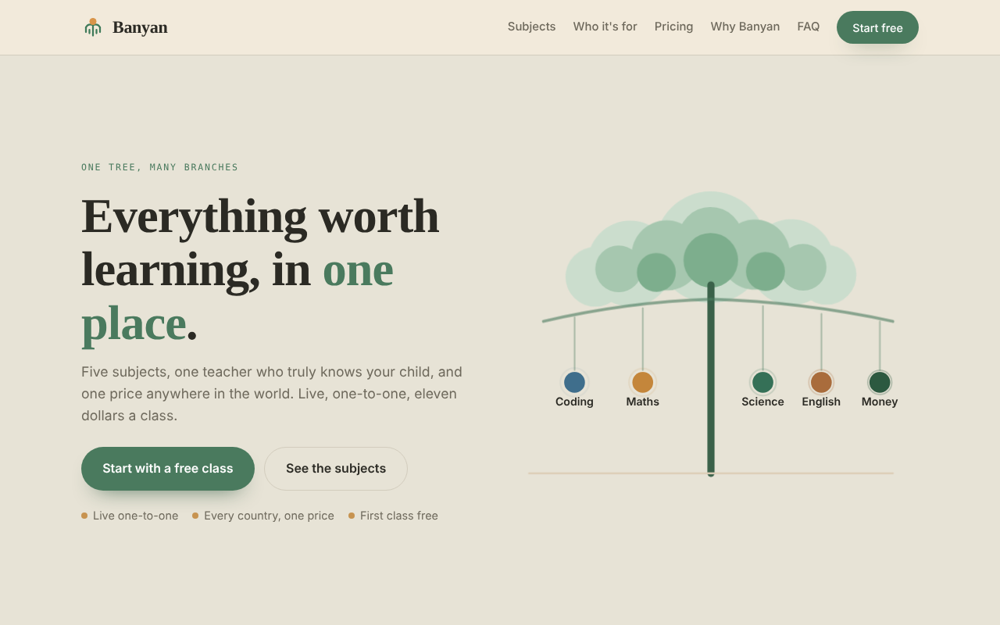

# Banyan

The website for Banyan, a live one-to-one tutoring service for children: coding, maths, science, English and money skills, one teacher per child, one price in every country.

**Live:** [learnbanyan.com](https://learnbanyan.com)



## What the site does

- **Subject explorer:** an interactive tree of the five subjects, with curriculum details per subject and region.
- **Booking flow:** a multi-step form to book a free first class, with validation for email and international phone numbers (country dial codes).
- **Automated enquiry pipeline:** every booking is posted to a Google Apps Script web app, which writes it to a live Google Sheet and sends an instant email alert. No manual data entry.
- **Cross-border payments:** a separate plan page (`/pay`) collects payments in USD through PayPal, so families abroad can pay in their own currency.
- **Content:** pricing, FAQ and a sample class video.

## How it works

| Part | Choice |
|---|---|
| Front end | Plain HTML, CSS and JavaScript, no framework |
| Backend | Google Apps Script web app connected to Google Sheets and Gmail |
| Payments | PayPal checkout in USD |
| Hosting | GitHub Pages on a custom domain |

## Structure

```
index.html        Landing page, subject explorer and booking form
pay/index.html    Plan and payment page
docs/             Screenshots
```

## Run it locally

Open `index.html` in a browser. The booking form posts to the Apps Script URL in the code; replace it with your own deployment to test submissions.
